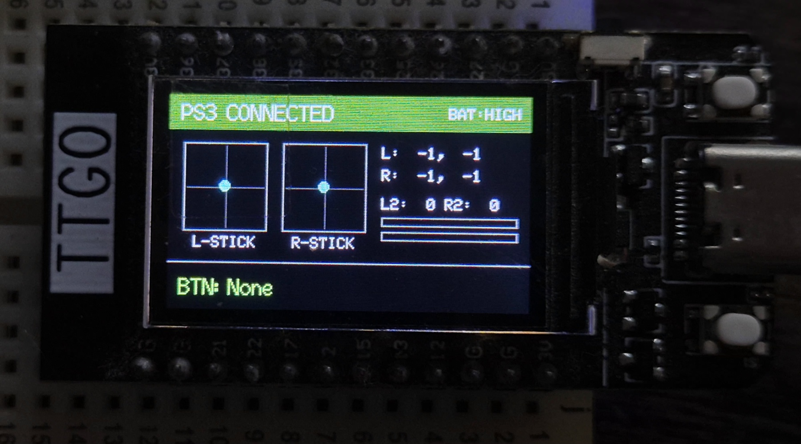

# ps3car


Controlling a robot car with a PS3 Dualshock controller

## Vision

The working T300 robot with an Arduino and Motorshield should be able to controlled from a PS3 controller. The translation is done by an ESP32, specifically a T-Display. The T-Display is only connected by 4 pins to the motorshield: 
- 5V
- GND
- TX of the T-Display to RX on the Arduino (3.3 Volt)
- TX of the Arduino to the RX of the T-Display over a 1 kOhm/ 2kOhm voltage divider to ground

The latter reduces a 5V high of the Arduino to a 3.3 Volt high at the input of the ESP32.

## Documentation

Tai is testing the 1kOhm/2kOhm of the motorshield to confirm the ESP32 is not destroyed by the 5 Volt signals of the Arduino.

Đo giá trị của các chân

  - Chân 1 và chân rx trên motorshield: 12,73 mega ohm(I dont know but the clock show that)
  - Chân GND và chân rx trên motorshield: 12,59 mega ohm(I dont know but the clock show that too)
  - Oh and what pin of t-display is rx???

For the connection we have a picture of the 4 wires on the T-Dispay

*** IMAGE ***

## Software

### Step 1: Successful connection of the remote controller to the T-Display



*** IMAGE ***

### Step 2: 

Program code to translate the inputs of the PS3 controller to the Arduino serial protocol

Code:

``` c
#define CODE T-Display

// and more to come
```

## Pictures and logic

To follow, written by Tai

## Signed out hardware

Tai received a PS3 controller, a working T-Display with ESP32 and 4 MB flash, and a multimeter on 2026/11/23 at Hung Vuong 1.
