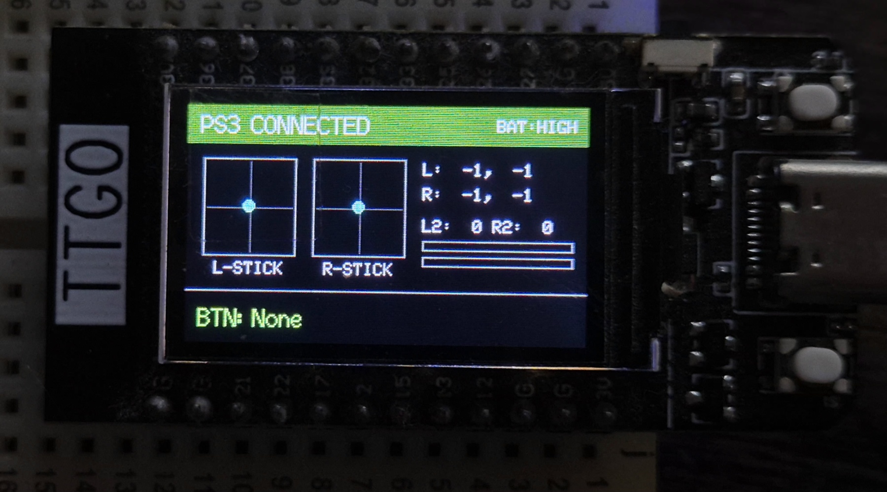

# Control a remote car with your PS3 controller

The controller is readily availble and for a low price. The classic Bluetooth connection is a little antiquated, but reliable and supported by the ESP32. So let's write some software for connection! This is how it looks:

